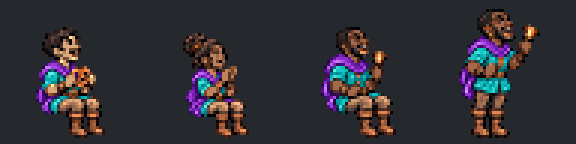
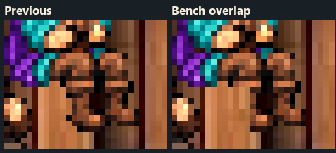
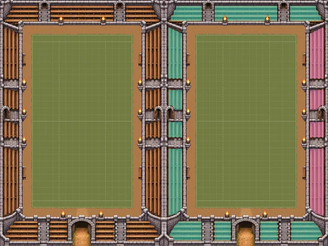
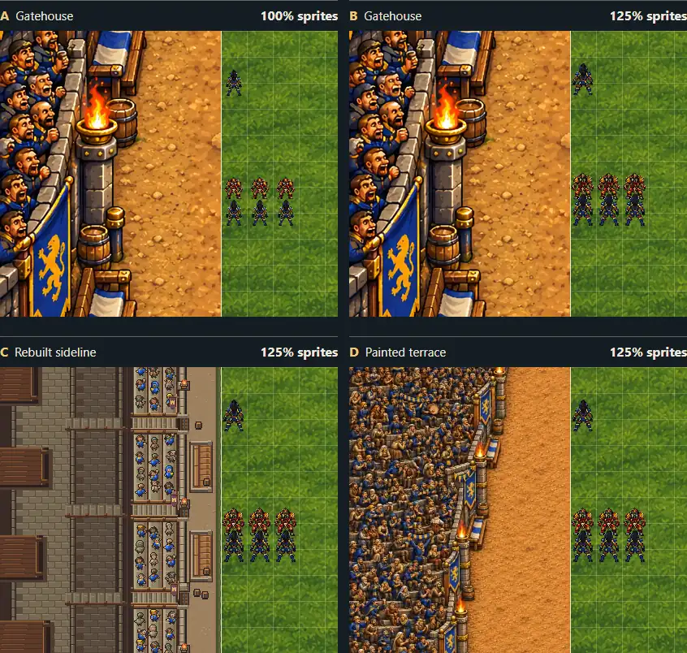
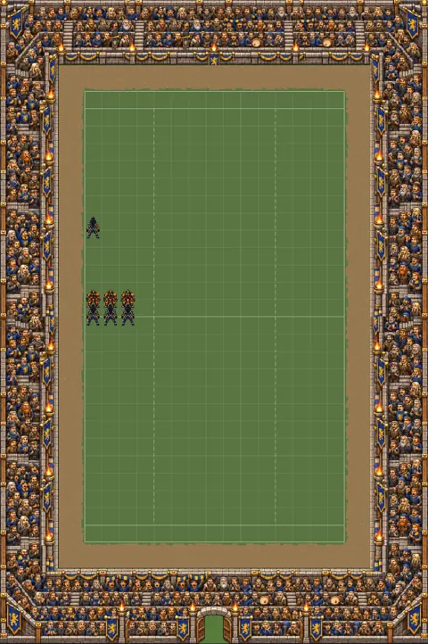
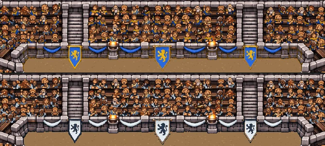

# Gatehouse scale and colour studies

## West bay 6 · Crowd density review

The gallery opens at 75% attendance with nine supporters in west bay 6, three each on the wall, rear and inner benches. On each bench the occupied hip or boot contacts are 18–23 native pixels apart. The wall-side supporters perch toward the front of their plank, leaving room for their backs inside the bay. The nearby blitzer gives a game-scale reference.

The 75% section includes the seated clapping supporter on the inner bench and the standing handbell ringer on the rear bench. At full attendance, the moustached supporter with a pretzel takes the seat just north of the clapping supporter. The ringer also has a seated pose. In the preview below the three complexions range from light olive-brown through warm medium brown to deep brown. Faces, hands, food and brass keep their colours across kits.

| Gallery view | Occupied seats | Seated | Standing | Neutral clothing |
| --- | ---: | ---: | ---: | ---: |
| A · 100% full | 12 of 12 | 11 | 1 | 4 |
| B · 75% full | 9 of 12 | 8 | 1 | 3 |
| C · 50% full | 6 of 12 | 5 | 1 | 2 |

Open `/stadium-mockup` and use **Gallery view** to change attendance. Returning fans keep the same seats, gestures and clothes. Compare the views at native size and 4×, or scroll down to see the whole pitch. **Seat markers** shows empty places as grey squares, hip or boot contacts as cyan crosses and seated knees as gold dots. **Inspect full poses** shows each occupied seat in its assigned kit before overlap. **Inspect all 10 poses** shows all eight supporters, including both stances for the cheering supporter and the handbell ringer.

Turn off **Front rail** to inspect how each plank covers the back of a seated calf. This detail from the bench-fit proof shows the effect on the folded-arms pose.

Enable **Bench tops** in any gallery view to highlight the 64 individual planks. In **Empty stadium** this shows the full layout for a stadium artist. With a west-bay crowd selected, combine **Bench tops** and **Seat markers** to inspect hip and boot placement. The gallery and the crowd builder read the same [reusable bench geometry](../../assets/game/references/stadiums/scale-studies/gatehouse-benches.json).

## Empty Gatehouse

Open the development gallery at /stadium-mockup. **Empty stadium** shows the permanent timber terraces, access stairs, cold braziers, bare sidelines and south gate in the reference palette. **Show seating masks** identifies 15 bays. Teal marks home seating, and pink identifies the four bays on the east side. Each bay has its own integer ID in the native mask. The [bay dimension manifest](../../assets/game/references/stadiums/scale-studies/empty-seating.json) records the native origin, width, height and pixel count of each bay. The [fit checks](../../assets/game/references/stadiums/scale-studies/README.md) use the approved pixel outlines, including their cutouts.

## Earlier gallery rounds

Open `/stadium-mockup` in the development gallery. From `browser-client`, run `npm run dev:stadium` and use the address printed by Vite.

The original review compared a reconstructed stadium to its painting. That established fidelity but missed the scale mismatch visible when a player stood near a barrel or a supporter. These studies put a touchline player and adjacent opponents in the same crop.

| Study | Player artwork | Sideline |
| --- | --- | --- |
| A | Original size | Approved Gatehouse |
| B | 125%, scaled about the planted feet | Same as A |
| C | 125%, same placement as B | Smaller spectators and props, drawn at pitch scale |
| D | 125%, same placement as B | Densely populated painted terrace with smaller faces and a dirt apron |

Compare A and B at the line of scrimmage to see how much room the larger figures leave between adjacent squares. Compare B and C at the touchline to judge the height of the supporters, benches and barrels. The playing grid stays at 32 native pixels per square.

### Material design

The new sideline starts with a transparent silhouette and explicit material assignments for tunics, hats and cloth. Skin, wood, iron, masonry, outlines and fixed neutral clothes have separate identities from team fabric, even when two materials happen to look similar in one colour scheme. Each fan gets a wardrobe assignment. Each bay has 12 supporters. Four wear fixed clothing, for a total of 16 out of 48. The other supporters use primary and secondary ramps with four shades each. The full strip and isolated figures share the same binary alpha at every figure edge.

Use the edge inspection view to check gaps between arms and bodies and the silhouettes of small props against light, dark and checkerboard backgrounds. Change the kits to inspect which surfaces follow the primary and secondary ramps. A good proof has clean edges, visible folds on both light and dark kits, and stable neutral clothing.

This is an overhead scale decision. The existing full Gatehouse gallery remains available for comparison. A full stadium redraw depends on the selected player and sideline scale.

Study D explores how the smaller figures read in Gatehouse’s painted style. Its 272 × 352 pixel terrace is a centred, downsampled crop of a newly generated 1070 × 1470 painting. Its crowd colours are baked into the concept. Study C is the working proof for recolouring and alpha. If D is selected, author its figures and fixtures separately with C’s material rules before assembling a full stand.

### Study E · Stepped Gatehouse bowl

The west touchline and the whole overhead bowl use the same 32-pixel grid. The playable field measures 15 by 26 squares. The inner wall sits 48 pixels (1½ squares) outside the chalk on all four sides. Uneven grass clumps extend 2–7 pixels into that dirt. The muted green turf has a sparse, low-contrast texture.

The new painting uses raised stone rows, heraldic pennants, doublets, mail and leather. Spectators are slightly larger than D and mix team colours with neutral clothing. The crowd is still painted in this review. For the production redraw, reserve both cloth ramps and assign fixed wardrobes to roughly one supporter in three using C’s tested method.

### Study F · Inward-facing Gatehouse bowl

The south supporters show their backs as they watch the pitch through the same overhead camera. The red-and-ivory away section occupies the east terrace, with cross-aisles descending through the seating bays toward the pitch. The other three terraces use home colours mixed with neutral clothing.

The entire stadium surround is one newly drawn foreground with a transparent opening. Its pointed standards, stonework and braziers extend over the dirt on their own silhouettes. The west crop uses the same players, turf, grid and apron as E. The bowl view selector also has native-size crops for the south gate, east away terrace and north banners. The gallery now draws individual spectators over the terraces. The 12 poses include cheering, drinking, eating, pointing, clapping and watching quietly. Of the 540 seats, 181 are assigned neutral wardrobes. The home and away primary and secondary ramps drive only the indexed clothes and heraldry. The south gates open directly onto the earth apron and the shaggy edge of the muted turf.

The two north-stand captures use the default and white/black kits. Hands, faces, neutral clothing and food keep their drawn colours.

