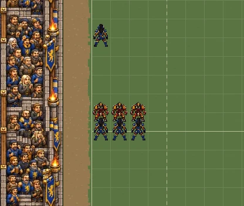
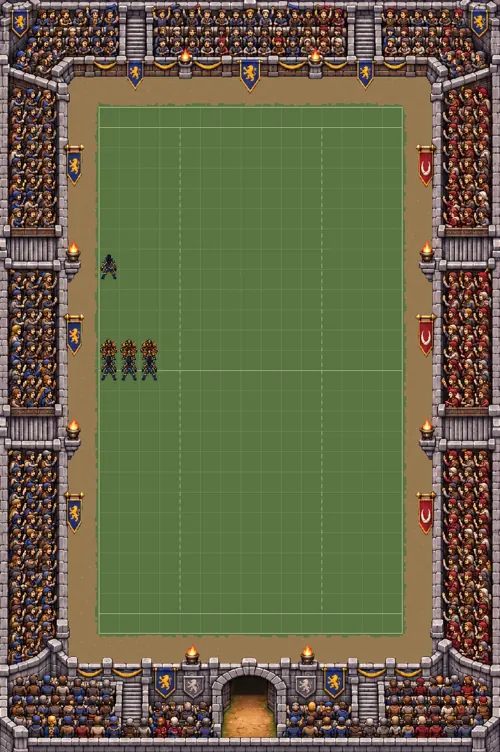

# Gatehouse scale and colour studies

The gallery now shows only the inward-facing Gatehouse bowl (Study F). Earlier studies below record the design history.

Open `/stadium-mockup` in the development gallery. From `browser-client`, run `npm run dev:stadium` and use the address printed by Vite.

The original review compared a reconstructed stadium to its painting. That established fidelity but missed the scale mismatch visible when a player stood near a barrel or a supporter. These studies put a touchline player and adjacent opponents in the same crop.

| Study | Player artwork | Sideline |
| --- | --- | --- |
| A | Original size | Approved Gatehouse |
| B | 125%, scaled about the planted feet | Same as A |
| C | 125%, same placement as B | Smaller spectators and props, drawn at pitch scale |
| D | 125%, same placement as B | Densely populated painted terrace with smaller faces and a dirt apron |

Compare A and B at the line of scrimmage to see how much room the larger figures leave between adjacent squares. Compare B and C at the touchline to judge the height of the supporters, benches and barrels. The playing grid stays at 32 native pixels per square.

### Material design

The new sideline starts with a transparent silhouette and explicit material assignments for tunics, hats and cloth. Skin, wood, iron, masonry, outlines and fixed neutral clothes have separate identities from team fabric, even when two materials happen to look similar in one colour scheme. Each fan gets a wardrobe assignment. Each bay has 12 supporters. Four wear fixed clothing, for a total of 16 out of 48. The other supporters use primary and secondary ramps with four shades each. The full strip and isolated figures share the same binary alpha at every figure edge.

Use the edge inspection view to check gaps between arms and bodies and the silhouettes of small props against light, dark and checkerboard backgrounds. Change the kits to inspect which surfaces follow the primary and secondary ramps. A good proof has clean edges, visible folds on both light and dark kits, and stable neutral clothing.

This is an overhead scale decision. The existing full Gatehouse gallery remains available for comparison. A full stadium redraw depends on the selected player and sideline scale.

Study D explores how the smaller figures read in Gatehouse’s painted style. Its 272 × 352 pixel terrace is a centred, downsampled crop of a newly generated 1070 × 1470 painting. Its crowd colours are baked into the concept. Study C is the working proof for recolouring and alpha. If D is selected, author its figures and fixtures separately with C’s material rules before assembling a full stand.

### Study E · Stepped Gatehouse bowl

The west touchline and the whole overhead bowl use the same 32-pixel grid. The playable field measures 15 by 26 squares. The inner wall sits 48 pixels (1½ squares) outside the chalk on all four sides. Uneven grass clumps extend 2–7 pixels into that dirt. The muted green turf has a sparse, low-contrast texture.

The new painting uses raised stone rows, heraldic pennants, doublets, mail and leather. Spectators are slightly larger than D and mix team colours with neutral clothing. The crowd is still painted in this review. For the production redraw, reserve both cloth ramps and assign fixed wardrobes to roughly one supporter in three using C’s tested method.

### Study F · Inward-facing Gatehouse bowl

The south supporters show their backs as they watch the pitch through the same overhead camera. The red-and-ivory away section occupies the east terrace, with cross-aisles descending through the seating bays toward the pitch. The other three terraces use home colours mixed with neutral clothing.

The entire stadium surround is one newly drawn foreground with a transparent opening. Its pointed standards, stonework and braziers extend over the dirt on their own silhouettes. The west crop uses the same players, turf, grid and apron as E. The bowl view selector also has native-size crops for the south gate, east away terrace and north banners. The gallery now draws individual spectators over the terraces. The 12 poses include cheering, drinking, eating, pointing, clapping and watching quietly. Of the 540 seats, 181 are assigned neutral wardrobes. The home and away primary and secondary ramps drive only the indexed clothes and heraldry. The south gates open directly onto the earth apron and the shaggy edge of the muted turf.

The two north-stand captures use the default and white/black kits. Hands, faces, neutral clothing and food keep their drawn colours.

