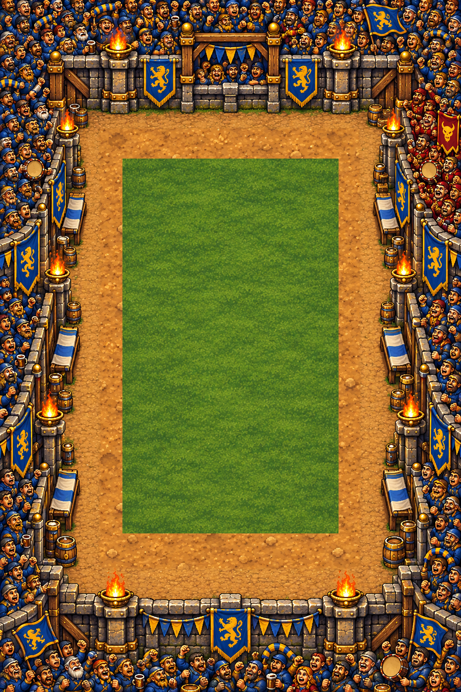
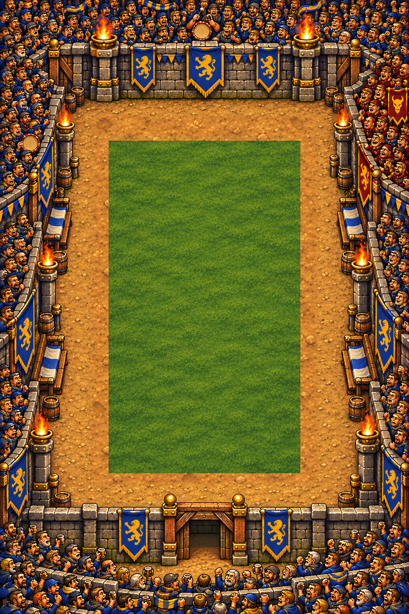
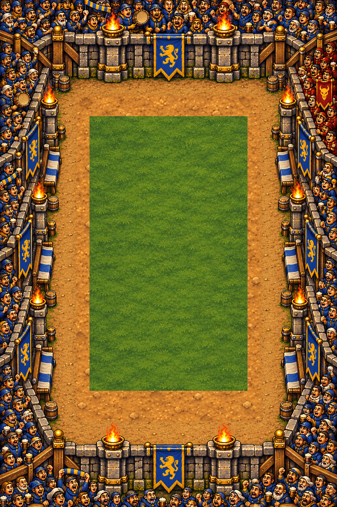
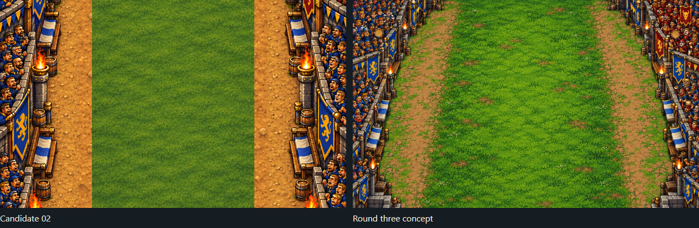

# Old World Classic stadium, round four

**Owner decision pending. Recommended still: 02, Gatehouse.** Choose one numbered still for the overhead stadium, or identify the visual change needed for another painting. Record the choice on [issue #572](https://github.com/the-grognard-codes/fumbbl-rebuild/issues/572) or its draft PR before extracting any layers.

| 01 · Drummers | 02 · Gatehouse | 03 · Lion wall |
| --- | --- | --- |
|  |  |  |
| Drummers flank the touchlines and a timber booth breaks up the far wall. | The broad far banners, alternating torch pillars and open near gate distinguish the two ends. | A compact visiting block and a single lion on each end wall give the cheering figures more room. |

### What to compare

Candidate 02 comes closest to the concept's foreground wall depth, hanging cloth and readable faces. Three differences remain visible. The sideline faces are larger and the bays repeat more regularly. The turf meets the apron at a sharper edge. Showing both end walls makes them more prominent than in the owner's cropped reference. The centre crop misses the red block at upper right, which is visible in the full still. Judge the face scale and wall rhythm using the cropped concept, then look at the full frame to judge the end walls. [Owner's concept](../../assets/game/references/stadiums/concept-round-3/01-old-world-classic-human-home.webp)

### How the stills were made

The earlier modular gallery split crowds into bands. Its overhead rendering showed heads from above, and its review captures missed the Orc team. This round starts from the home-end overhead gallery capture. Each candidate was painted as one scene using that capture, the owner's concept and the architecture sheet from #571. The crowd and walls retain the original positions, pixel density and lighting of each painting. [Previous review](https://github.com/the-grognard-codes/fumbbl-rebuild/pull/571#issuecomment-6938352174)

The native frame is 1024 × 1536 at 32 pixels per square. The playable rectangle starts at (272, 352) and ends just before (752, 1184). The raw paintings extended grass into the apron. A painted ochre ground sample fills the excess grass and the original grass fills the exact playable rectangle at 80% contrast. All source rasters and final pixels are native size. The preparation script works on the complete still, and lives beside the lossless source images, prompts and input references. [Layout capture](../../assets/game/references/stadiums/round-four/layout-base.png) · [Generation record](../../assets/game/references/stadiums/round-four/generation.json) · [Ground preparation](../../assets/game/references/stadiums/round-four/prepare.py)

### Review gallery and validation

From `browser-client`, run `npm run dev:stadium` and open `/stadium-mockup`. Full-resolution stills are also linked above. The gallery exercises both coach ends, pan and zoom, Human and Orc teams and colour pairs. Delivery excludes review assets. The UI drivers write evidence under the ignored `.tools/` directory.

The pre-approval checks passed all 555 browser tests and 31 asset checks, TypeScript, the production build, and the gallery, projected-pitch, playback and playback-motion drivers. The gallery driver verified 22 loaded player images and the complete 390-square grid. The native layout reproduced byte for byte. The final layered render, outside-pitch pixel difference, cloth-mask coverage, away-end stand ownership and readability on both painted turf presets require an approved still.

### After approval

Cut the selected still at native scale and compare the home-end reconstruction against it. Record the outside-pitch pixel difference, before/after captures, the cross-fade and the three largest remaining differences. After two rounds without convergence, revisit the method with the owner. Keep angled cameras on turf while the overhead result is assessed.
