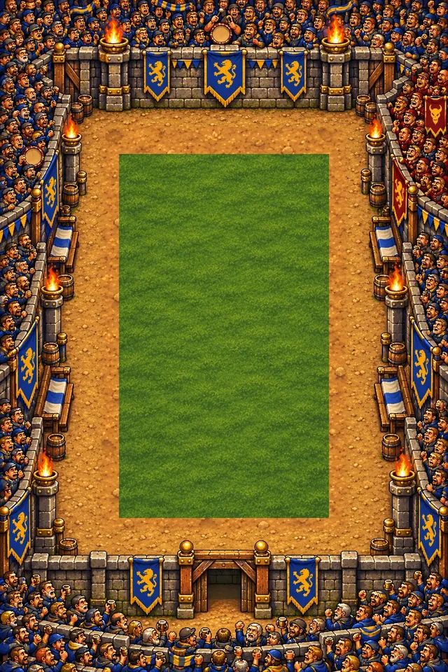
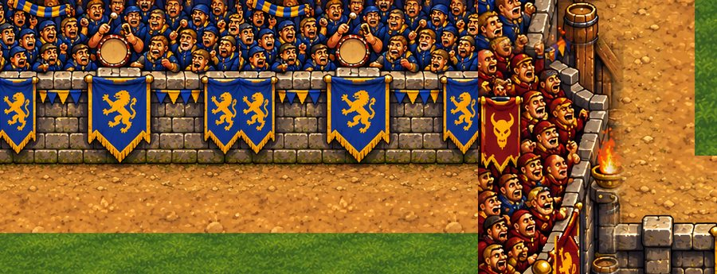

# Old World Classic stadium, round four

**Approved still: 02, Gatehouse.** On November 18, 2026, the owner selected the open near gate because it helps orient the viewer. The source for extraction is the approved 1024 × 1536 PNG, SHA-256 `c83343713f5f15296828a76ebba35ac801735437f414a4638f0d75e3bb7e0bb5`. [Approval record](https://github.com/the-grognard-codes/fumbbl-rebuild/issues/572#issuecomment-6988171353)

| 01 · Drummers | 02 · Gatehouse | 03 · Lion wall |
| --- | --- | --- |
|  |  |  |
| Drummers flank the touchlines and a timber booth breaks up the far wall. | The broad far banners, alternating torch pillars and open near gate distinguish the two ends. | A compact visiting block and a single lion on each end wall give the cheering figures more room. |

### What to compare

#### Neutral crowd clothing preview

This proposed revision places umber, tan, warm grey and charcoal clothing among the supporters. The native proof applies fixed ramps to 75 home and eight visiting spectator selections. The club banners and flags keep their colours. Open either image at full size to judge the balance. The layered gallery continues to use the approved Gatehouse still pending visual review.

| Approved Gatehouse | Proposed crowd mix |
| --- | --- |
|  |  |

To reproduce the lossless proof with Pillow 13, run `python assets/game/references/stadiums/round-four/layers/neutral_preview.py .tools/neutral-review/neutral.png` from the repository root. The WebP above is a compressed review copy. The lossless comparison changed 20,082 clothing pixels and preserved the full pitch and its two-square apron.

Candidate 02 comes closest to the concept's foreground wall depth, hanging cloth and readable faces. Three differences remain visible. The sideline faces are larger and the bays repeat more regularly. The turf meets the apron at a sharper edge. Showing both end walls makes them more prominent than in the owner's cropped reference. The centre crop misses the red block at upper right, which is visible in the full still. Judge the face scale and wall rhythm using the cropped concept, then look at the full frame to judge the end walls. [Owner's concept](../../assets/game/references/stadiums/concept-round-3/01-old-world-classic-human-home.webp)

### How the stills were made

The earlier modular gallery split crowds into bands. Its overhead rendering showed heads from above, and its review captures missed the Orc team. This round starts from the home-end overhead gallery capture. Each candidate was painted as one scene using that capture, the owner's concept and the architecture sheet from #571. The crowd and walls retain the original positions, pixel density and lighting of each painting. [Previous review](https://github.com/the-grognard-codes/fumbbl-rebuild/pull/571#issuecomment-6938352174)

The native frame is 1024 × 1536 at 32 pixels per square. The playable rectangle starts at (272, 352) and ends just before (752, 1184). The raw paintings extended grass into the apron. A painted ochre ground sample fills the excess grass and the original grass fills the exact playable rectangle at 80% contrast. All source rasters and final pixels are native size. The preparation script works on the complete still, and lives beside the lossless source images, prompts and input references. [Layout capture](../../assets/game/references/stadiums/round-four/layout-base.png) · [Generation record](../../assets/game/references/stadiums/round-four/generation.json) · [Ground preparation](../../assets/game/references/stadiums/round-four/prepare.py)

### Review gallery and validation

From `browser-client`, run `npm run dev:stadium` and open `/stadium-mockup`. Full-resolution stills are also linked above. The gallery exercises both coach ends, pan and zoom, Human and Orc teams and colour pairs. Delivery excludes review assets. The UI drivers write evidence under the ignored `.tools/` directory.

The pre-approval checks passed all 555 browser tests and 31 asset checks, TypeScript, the production build, and the gallery, projected-pitch, playback and playback-motion drivers. The gallery driver verified 22 loaded player images and the complete 390-square grid. The native layout reproduced byte for byte. The driver also exercises the approved layered stadium with both teams, both turf presets, five colour pairs, all visibility toggles, both ends, 50%, 100% and 200% zoom, and pan.

### Reconstruction review

#### First cut

The approved still, first home reconstruction and away visiting-section detail appear below, left to right. A native Chromium screenshot changed 3,622 of 1,173,504 outside-pitch pixels (0.309%). All 399,360 pitch pixels matched. The largest differences were alpha rounding at the home visiting-section edge, a second torch in the relocated section and a banner crossing the near wall. This prompted an opaque home cut and a tighter away supporter silhouette.

The game-service build passed all 29 tests on the pinned JDK and Maven. The game server packaged successfully in quick mode. All 15 validation-inventory tests passed after the gallery driver was registered as a standalone development check.

#### Final cut

The home screenshot now matches the approved still in **all 1,572,864 pixels** at 100% zoom with the balanced turf, original colours, grid off and players off. An independent RGB comparison of the Chromium screenshot counted zero changes inside the pitch and zero in the 1,173,504 outside pixels. The cut script also checks a fresh reconstruction against the approved PNG. [Layer recipe and manifest](../../assets/game/references/stadiums/round-four/layers/manifest.json)

The intended differences in the other views are visible below. First, the relocated away supporters use the destination's torch, wall and barrel. The visiting section moves from upper right to lower left, the gate stays at the bottom and the heraldry reads upright. Second, the calm preset reduces turf contrast across the 399,360 playable pixels with zero changes elsewhere. Third, changing the visitor or kits changes the crest, the selected cloth and the player uniforms. The Human visiting standard uses a lion taken from the same painting. The native balanced view retains the original visiting standard.

The gallery can cross-fade the live render against either the approved full still or the cropped concept. The automated check compares both endpoints and the midpoint. The archived thumbnail shows the midpoint against the approved still. Run `npm run test:stadium-mockup` in `browser-client` to reproduce the full-size browser captures and pixel counts under `.tools/stadium-mockup/`. [Home cross-fade](../../assets/game/references/stadiums/round-four/home-crossfade.jpg)

**Angled cameras.** Keep the gallery's 30, 40 and 50 degree views on turf. The approved painting uses upright faces and banners on both sidelines. A perspective stadium needs its own visual target before work starts on angled architecture or crowds. Live match rendering continues to use its existing assets.
